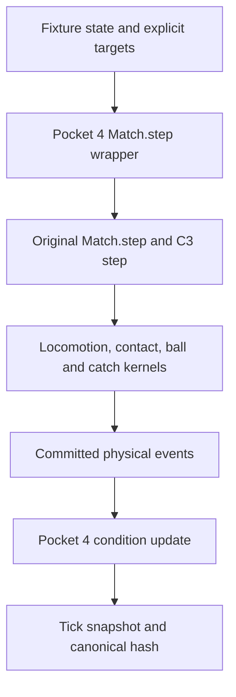

# HP-001 T3 — Physics Golden Traces

**Date:** 2026-11-05  
**Disposition:** T3 evidence complete; stopped before T4.  
**Accepted baseline:** B0-P4-DEFAULT at `2abe497ca82588cb2d8c871a7aab61daaae95c12`.

## 1. Result

Ten deterministic, tick-level physical traces were generated in fresh processes and then generated a second time in ten additional fresh processes. All ten trace pairs are byte-identical and have identical canonical trace hashes. Eight traces use the historical B0 code and effective feature configuration. Two are explicitly classified controlled Pocket 4 feature studies and are not B0.

No file in the reconstructed accepted baseline changed during generation. The before/after non-cache repository digest was identical:

`72dc27935e94fd548b94371966e15c267acfbb7e8e213733a4d3500765d34283`

The T1 key-source SHA-256 values all matched before and after generation. Of the 427 blobs in the accepted commit-tree listing, all 212 locally reconstructed blobs were rechecked against their Git blob IDs with zero mismatches; the other 215 were already covered by accepted T1 and were not re-fetched in T3.

T3 made no physics, ratings, rules, cognition, roster-mapping, or native-code change. Historical B0 kicking remains installed and unchanged. No kick was requested by these fixtures.

## 2. Trace classifications and configurations

| Profile | Cases | Classification | Environment changes from B0 | Effective distinguishing state |
|---|---|---|---|---|
| `b0` | sprint, brake/cut, tackle/contact, catch, ball flight, bounce, fatigue, sampled throw | `historical_b0_physics_microstate` | None; all covered feature variables cleared before import | `CATCH_V2=0`, `KEEPER_STEP_FRAC=0.5`, `PRISM_JSPLIT=0`, `PRISM_KEEPER=0`, `RULESET=1.0.1`, `THROW_SPLIT=1`, spherical ball |
| `controlled_catch_v2` | catch_v2 | `controlled_pocket4_feature_microstate` | `CATCH_V2=1`, `PRISM_CATCHERS=0` | Catch-v2 patch active; otherwise the same systems, settings, assumptions, and spherical shape as B0 |
| `controlled_prolate_throw` | prolate_throw | `controlled_pocket4_feature_microstate` | No environment flag; fixture selects `S.shape=prolate1.5` | Pocket 4 sampled release and shape-dependent handling use `prolate1.5` |

Common canonical hashes:

- Settings: `adeb6e03f8d31ab96d674972a262a19ca3a4923f63c68c0c757702d05fd4c7ef`
- Enabled-system list: `7012ea79da78e2f31d86d79fea36fe88177c36f7bbd18101596ea617edde36e2`
- B0 and catch-v2 derived assumptions: `9bdec950ae93ea732cb8560489da8dcc391557048ec82fe0046b4269a27897fd`
- Prolate derived assumptions: `0237fc8b62997972371a7022dc56b4ddfcf03349e6d2016daf85bb4957dae056` (shape-dependent catch-capacity adjustment)
- Calibration: `64d5e1a6f4fde5c23a7444bec144bf5299106b30bc8204a03927c739e7052599`

Each artifact additionally records its seed-specific roster hash, complete settings, derived assumptions, enabled systems, athlete attributes, Pocket 4 base limits, roster extras, and condition ratings.

The B0 label here means **B0 runtime code/configuration under a controlled physical microstate**. These files do not replace the accepted T1 full-match historical outputs.

## 3. Cognition/physics boundary

The test harness supplies initial physical state and explicit target coordinates. On each in-memory match instance it replaces `policy.targets` with an explicit target provider and disables carrier, archer, receiver-routing, and C4c2 target decisions. It does not replace `Match.step`, C3, the engine, ball integration, catches, contact, condition, or Pocket 4 wrappers.



Decision-derived behavior excluded from the golden reference:

- legacy formation/positional target selection;
- PRISM cognition and perceived-state choice;
- carrier pass/shot/kick choice;
- receiver rerouting;
- archer target/release choice;
- C4c2 target overrides.

Physical behavior retained:

- target acceptance and the installed locomotion limits;
- C3 drift/kick integration, 10 ms contact substeps, holds, impulse exchange, balance, grounding, and tackle resolution;
- ball release state, gravity, drag, ground restitution, rolling loss, boundary handling, swept catch contact, catch security, and control;
- Pocket 4 release sampling when the release is not forced;
- condition reserve, wear, strain, damage, status, and the 3-second dynamic capability refresh.

This boundary is implemented at `tools/trace_scenario.py:289-309`. The runtime call chain is independently visible at:

- `repo2abe497/pocket4_proto.py:363-370` — Pocket 4 step wrapper and post-step condition hook;
- `repo2abe497/Beastball Pocket 2 0(1).py:5222-5293` — original match step, policy targets, C3 path, decisions, and event processing;
- `repo2abe497/Beastball Pocket 2 0(1).py:3948` — C3 step;
- `repo2abe497/Beastball Pocket 2 0(1).py:4059-4088` — C3 movement and target acceptance;
- `repo2abe497/Beastball Pocket 2 0(1).py:4197-4263` — 10 ms contact integration and impulse/hold phases;
- `repo2abe497/Beastball Pocket 2 0(1).py:4877-4926` — ball flight, drag, bounce, boundary, and catch dispatch;
- `repo2abe497/Beastball Pocket 2 0(1).py:4956-5071` — swept catch and security model;
- `repo2abe497/pocket4_proto.py:259-290` — condition update and dynamic capability limits;
- `repo2abe497/condition_layer_v2.py:45-66` — contact/usage wear and condition step;
- `repo2abe497/beastball_locomotion_v37.py:45-57,95-111` — fatigue valve terms and reserve integration.

## 4. Recorded schema and precision

Every row records the full Python double-precision values without display rounding:

- tick index, absolute match time, actual `dt`, fixture phase label, match phase, and owner;
- subject position, velocity, finite-difference acceleration, speed, facing, accepted target, external command target, activity, role, posture, fatigue field, action/decision deadlines, and current speed/acceleration/braking/turning limits;
- condition reserve, status, wear by body part, damage, strain, and cause;
- ball position, velocity, finite-difference acceleration, speed, mode, carrier, last touch, last releaser, intended receiver, version, and scoring state;
- C3 engagements, C3 holds, and complete newly committed engine event records.

Acceleration in the artifact is the change in exposed velocity divided by the actual row interval. It is therefore a parity observable, not a claim that the engine maintains an independent continuous acceleration state. Teleports, grounding, boundaries, and other event discontinuities appear as large finite-difference acceleration values.

The normal match tick is 100 ms. The original engine shortens a step at deadlines and swept physical events; those shortened intervals are retained exactly (for example, catch and contact rows include 15–100 ms and 98–100 ms intervals). C3 integrates interacting athletes internally at 10 ms or shorter event cuts. T3 records the externally committed match tick plus the engine's event timestamp and full C3 state, not a new debug callback at every internal C3 substep.

## 5. Golden trace inventory

| Scenario | Profile | Seed | Rows | Physical duration | Canonical trace SHA-256 |
|---|---|---:|---:|---:|---|
| sprint | b0 | 73001 | 41 | 4,000 ms | `15ef6620bb830cf7550b14526fc30a993eb84e13d8f3fa7d01ed71fbb0eafc30` |
| brake_cut | b0 | 73002 | 36 | 3,500 ms | `6f598f40554824e0569ce4769fa2b4e898daba341fa12fa0dbe0b78f852d073a` |
| tackle_contact | b0 | 73003 | 18 | 1,698 ms | `0aa8ca1c4fb749bf78a7d1d845058493f07364dde40bddffc48e7493531a01f3` |
| catch | b0 | 73004 | 12 | 917 ms | `60ce6ea0e44f0a36e204036c9b320e17815e109de92a939905c43c44e2aa82ba` |
| ball_flight | b0 | 73005 | 28 | 2,593 ms | `fb47b0a4a20984b6a33019cfd3c7e1e9980aad5e0a8bc72d488b33cabfba2d3b` |
| bounce | b0 | 73006 | 33 | 3,087 ms | `27ac84538c90338c66bfbb7165bc76607824e235a44e34ef63141cb8282378da` |
| fatigue | b0 | 73007 | 301 | 30,000 ms | `a1ffe1e2a76559e880196e487fc01b0534f27b3201caaa398feaba52ad6fbeab` |
| throw_release | b0 | 73008 | 28 | 2,567 ms | `84d6c2a2d9749fe1d6d4e586170f97cf8b28ee19ef7a4fe98d1ea212cf526014` |
| catch_v2 | controlled_catch_v2 | 73104 | 12 | 916 ms | `2817799d9ffcf2d0f9cd58ab453863f05742b56fdec84ecef6b849d687fc5a79` |
| prolate_throw | controlled_prolate_throw | 73108 | 28 | 2,582 ms | `5b14dfa7d2c98ef919fd01a364869bb14a7b35d0614cc550a2c3e852f729a61b` |

Full file SHA-256 values, duplicate-run hashes, event counts, commands, and artifact-content hashes are in `MANIFEST.json`.

## 6. Observed physical outcomes

| Case | Golden outcome |
|---|---|
| Sprint | A0 accelerates from rest to a maximum exposed speed of `30.47700475343834 m/s`; after 4 s its reserve is `0.9294502773519081`. Boundary proximity and the installed target integrator's late-course behavior are preserved, not corrected. |
| Brake/cut | Input begins at `20 m/s`; phases are entry (through 1,700 ms), hard brake (1,800–2,800 ms), then a 90-degree cut (2,900–4,500 ms absolute match time). Final velocity is `[0.011819169854000375, 30.443700147616234, 0] m/s`; reserve is `0.9478333778413194`. |
| Tackle/contact | Engagement and hold begin at 1,700 ms; collision is committed at 1,900 ms; hold end, C3 grounding, C3 down, tackle count, restart award, and scrimmage set are committed at 2,198 ms. The ball resolves dead. Five later committed ticks are retained. |
| B0 catch | Forced exact launch is `[26.621781923159883, 0, 4.5034128431354885] m/s`; A1 controls the ball at 1,917 ms. This isolates the B0 catch kernel from release-error sampling. |
| Catch-v2 | Controlled feature launch is `[26.634105459137345, 0, 4.429946544999196] m/s`; A1 controls at 1,916 ms. Its one-millisecond difference from B0 is evidence for this fixture, not a recalibration recommendation. |
| Ball flight | Forced release starts `[24, 3.5, 11] m/s`; at the final row the loose ball is at `[80.7270066125371, 58.74592492266165, 1.8356109462049708] m` with velocity `[17.544174976493387, 2.5585255174052848, 7.641603310122741] m/s`, after its first ground response. |
| Bounce | Loose ball starts at `[32,50,4] m`, velocity `[16,2,-3] m/s`. Clean ground reversals occur at 1,687 ms and 3,287 ms at `z=0.1075 m`; post-impact velocities are respectively `[12.035334641473815,1.504416830184227,7.489802968520986]` and `[8.929943169195168,1.116242896149396,6.340328780991999] m/s`. |
| Fatigue | A0 shuttles between x targets 30 m and 70 m for 30 s with no stoppage. Reserve/fatigue falls monotonically from `1.0` to `0.6196216655529978`; maximum exposed speed is `26.330562669520365 m/s`. Dynamic limits and all condition parts are recorded each tick. |
| B0 sampled throw | Requested `[32,5,7] m/s`; unchanged Pocket 4 spherical sampling produces `[32.129477424841745,5.51492457241306,6.841777966098792] m/s`. The later bounce and boundary/dead-ball result are part of the preserved trace. |
| Prolate sampled throw | Same request under the controlled prolate profile produces `[31.975198757690936,4.733775081475574,6.783524988781418] m/s`; subsequent flight/bounce remains physically resolved by the installed runtime. |

The catch and ball-flight fixtures deliberately force the requested release so they test catch/flight kernels without adding Pocket 4 throw error. The two sampled-throw fixtures separately preserve and test the release wrapper itself.

## 7. Repeatability and provenance

Runtime:

- CPython `3.12.14`
- NumPy `2.3.5`
- Linux `6.18.57` x86-64, glibc `2.41`
- Manifest SHA-256 before report assembly: `a28ae50e8fc46d00f0712dbdbc9a668d04310aadb92343847acc1a8e6182063e`

Each case was launched twice as a separate interpreter process. For every case:

1. the canonical `trace` SHA-256 matched;
2. the canonical artifact-content SHA-256 matched;
3. the complete formatted JSON file SHA-256 matched;
4. the files were byte-identical.

The copies of `generate_packet.py`, `trace_scenario.py`, and `verify_packet.py` shipped inside this packet were then used from their packaged location to generate a third set. All ten third-run trace hashes and complete trace-file hashes matched this packet. The third manifest itself has a different hash because its recorded absolute output paths and command strings correctly identify the new directory.

The verifier also asserts required physical coverage, B0/controlled-profile separation, the expected event chains, two clean bounce reversals, uninterrupted fatigue depletion, and accepted source identity.

From the workspace root:

```bash
python HP-001_T3_FINAL_PACKET/tools/verify_packet.py
```

Expected status: `PASS`, 10 cases, byte-identical repeats, baseline preserved.

To regenerate into a new directory without overwriting this packet:

```bash
python HP-001_T3_FINAL_PACKET/tools/generate_packet.py --out-dir HP-001_T3_REPRO
python HP-001_T3_REPRO/tools/verify_packet.py
```

Individual case form:

```bash
python HP-001_T3_FINAL_PACKET/tools/trace_scenario.py \
  --scenario sprint --profile b0 --seed 73001 --duration-ms 4000 \
  --out sprint.json
```

The exact command for each case is also stored in the manifest.

## 8. Proposed native comparison tolerances

Same-environment Python reruns have a zero-tolerance gate: canonical hash and full bytes must match exactly.

For a future cross-platform native implementation, use exact structural gates first and numerical envelopes second:

| Observable | Proposed gate |
|---|---|
| Scenario seed/config/profile, row count, categorical state, ball mode/carrier, event type/order/count, contact/hold membership | Exact |
| Scheduled 100 ms tick time and discrete deadlines | Exact integer milliseconds |
| Swept/contact event timestamps | `±1 ms`, while preserving order and containing tick |
| Non-contact position and velocity | `atol=1e-6 m` / `1e-6 m/s`, `rtol=1e-9` per row |
| Contact/bounce position and velocity | `atol=1e-4 m` / `1e-4 m/s`, `rtol=1e-8` per row |
| Derived non-contact acceleration | `atol=1e-5 m/s²`, `rtol=1e-8` |
| Derived acceleration across event discontinuities | `atol=1e-3 m/s²`, with exact event identity |
| Reserve/fatigue and dynamic capability limits | `atol=1e-8`, `rtol=1e-9` |
| Wear, strain, and damage | `atol=1e-10`, `rtol=1e-9`; exact zero/nonzero and status transitions |
| End-of-trace cumulative position/velocity | Same case-class tolerance; no separate drift allowance |

These are proposed starting tolerances, not validated native acceptance limits. A native port should first report maximum absolute/relative error by field and tick. Tolerances must not be widened merely to hide branch, event, integration-order, or formula differences. Any event-sequence divergence is a failure even when later coordinates happen to fall inside an envelope.

## 9. Ambiguities and future validation obligations

1. No native implementation exists in T3, so the proposed cross-platform tolerances have not been empirically validated.
2. Internal C3 substeps are not separately emitted as trace rows. Their committed event times and resulting hold/contact states are captured. If a native implementation diverges inside a 100 ms contact tick, add an observational substep probe in the validation harness without changing the solver.
3. Finite-difference acceleration includes event discontinuities and must not be mistaken for a force-level state variable.
4. These microstates deliberately suppress legacy decisions. They validate physical response to an explicit command, not the quality or correctness of target choice.
5. Full-match B0 parity remains governed by accepted T1. Passing these microtraces alone cannot prove full-match parity.
6. The controlled catch-v2 and prolate traces are feature evidence only. They cannot be merged into or used to redefine B0.
7. Catch and sampled-release outcomes consume deterministic RNG streams. Native parity must match the recorded random-consumption order or expose the same sampled inputs explicitly.
8. The B0 sampled throw reaches a boundary and dead-ball state. That is preserved behavior, not a proposed rules outcome or physics repair.
9. T3 did not recalibrate ratings, adjudicate whether observed magnitudes are canonically correct, or resolve T2 architecture conflicts.

Recommended future native validation sequence, after authorization for the relevant task:

1. parse and schema-check all ten artifacts;
2. reproduce the explicit initial conditions without any cognition module;
3. compare exact categorical/event timelines;
4. compare continuous state row by row using the proposed case-class envelopes;
5. produce field/tick maximum-error reports;
6. run the accepted T1 full-match matrix as a separate parity layer;
7. treat any need to alter reference physics, ratings, or rules as a new approved change, never as a T3 adjustment.

## 10. Scope closure

T3 is complete and stops here for review. T4 has not begun. No physics repair, rating recalibration, cognition repair, formation-free implementation, migration, or native rewrite was performed.

