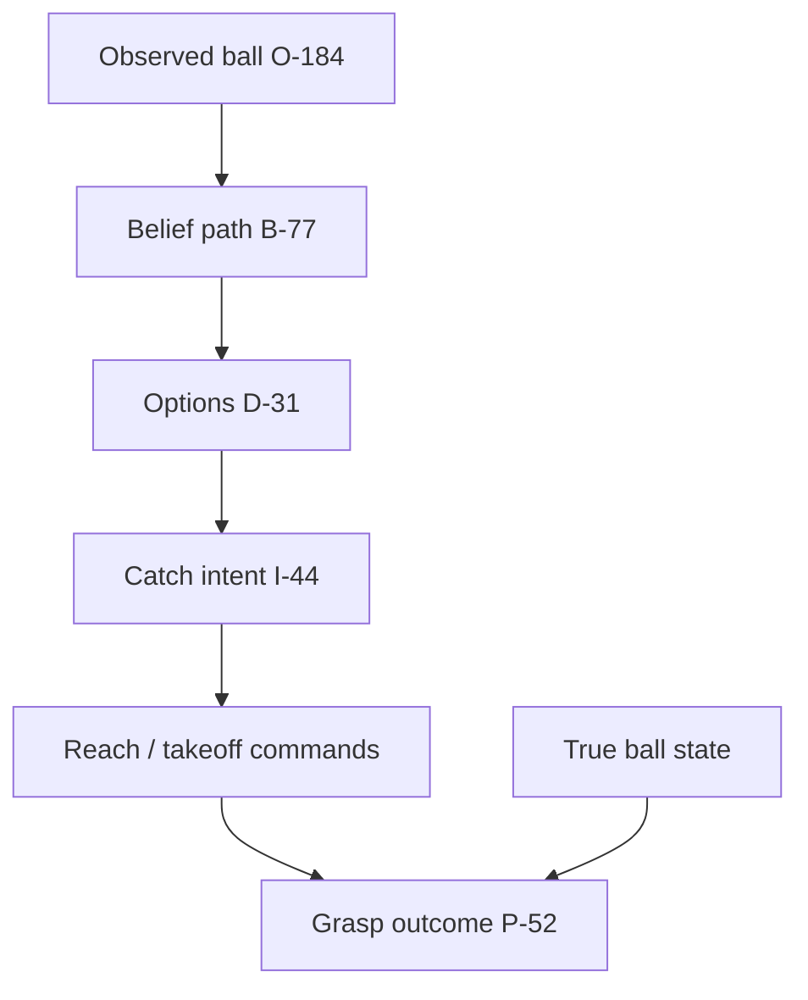

# Decision-Tick Data Flow Example

This example is normative for causal separation, not a new policy. It shows a
receiver preparing for a catch; numeric values and action choice are illustrative.

| Stage | Record | Owner | Required causal content |
|---|---|---|---|
| 1 | `ObservationFrame O-184` | observation projector | ball was captured at 1380 ms and delivered at 1400 ms; receiver/ball observations include uncertainty |
| 2 | `BeliefState B-77` | receiver belief update | inferred ball path and arrival distribution based only on O-184 and prior belief |
| 3 | `DecisionTrace D-31` options | receiver cognition | hold route, adjust intercept, prepare standing catch, prepare jump catch; each value or explicit unavailable reason |
| 4 | `CatchPrepareIntent I-44` | receiver cognition | selected intercept region, technique, readiness window, and reach mode; no true ball handle |
| 5 | `ReachCommand C-90` | receiver MC | accepted at 1410 ms; hand/body trajectory starts 1460 ms; own-body limits and error record |
| 6 | optional `TakeoffCommand C-91` | receiver MC | emitted only if I-44 requested jump and MC accepted it; same root intent |
| 7 | `PhysicalOutcome P-52` | PHY/rules | true swept contact at 1517 ms, relative speed, grasp/security result, possession event, state revisions |
| 8 | trace closure | telemetry observer | D-31 links O-184, B-77, I-44, C-90/C-91, P-52 and all draw IDs without consuming a draw |

If the ball has changed path after capture, cognition may still choose the same
intent. MC does not correct the semantic target from truth. PHY resolves the
actual contact and may report `missed`, `no_contact`, `bobbled`, or `caught`.
If contact or a new intent interrupts the command, the outcome names the cause;
the pending intent is never silently replaced.
