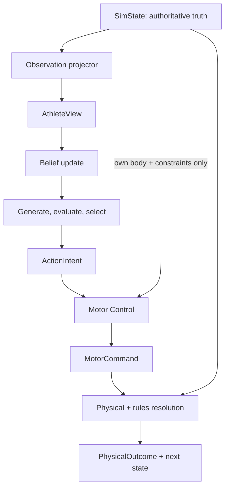
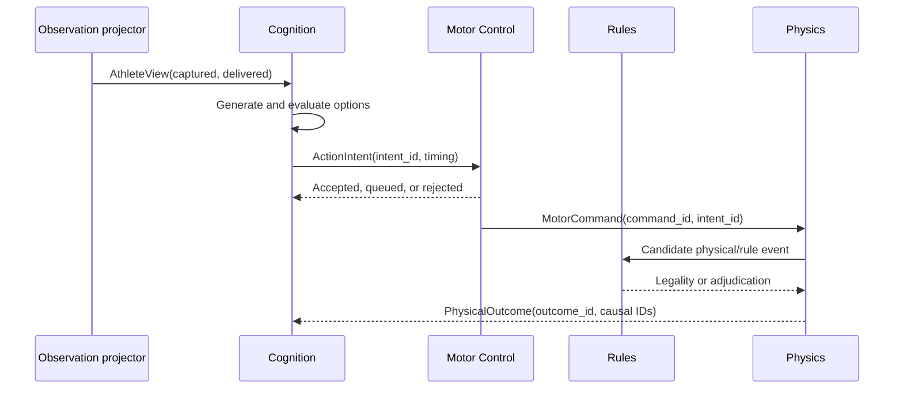

# HP-001 T6 — Native Interface Specification

## 1. Purpose and conformance

This specification defines a portable boundary for a future Beastball simulator
while preserving three distinct validation questions:

1. **Historical preservation:** can the B0 adapter reproduce accepted
   `B0-P4-DEFAULT` evidence?
2. **Physical parity:** does a physical engine produce the same result when it
   receives the same state, commands, environment, and modeled random draws?
3. **B1 correctness:** does future cognition obey IA-001 and approved rules,
   even where its decisions intentionally differ from B0?

An implementation conforms only if it passes the applicable gates in
`VALIDATION_MATRIX.md`. Passing one gate does not imply either of the others.
Recorded B0 physical magnitudes remain preservation references, not declarations
of canonical correctness.

## 2. Architectural layers and authority

| Layer | Reads | Produces | Exclusive authority |
|---|---|---|---|
| Observation projector | authoritative state, visibility model, public rules, delivered communication | immutable `ObservationFrame` / `AthleteView` | Convert true state into legitimately available information |
| Belief update | athlete view, prior belief, own knowledge | `BeliefState` revision | Athlete-specific inference and uncertainty |
| Option generation | athlete view, belief, knowledge, current commitments | typed candidate intents | Which actions are considered |
| Evaluation and selection | candidates, athlete view, belief, policy parameters | selected `ActionIntent`, `DecisionTrace` | What the athlete intends |
| Motor Control (MC) | selected intent, executing athlete's own body state, authorized physical constraints | accepted/rejected/queued `MotorCommand` | How that athlete attempts the selected action |
| Rules/adjudication | true state, public and internal rule state, command/event | legality/restart/penalty decisions | Rule legality and administrative state |
| Physical resolution (PHY) | true state, accepted commands, environment, true physical attributes, named random draws | `PhysicalOutcome`, next state, physical events | What physically occurs |

Team planning and communication may influence observations or knowledge, but
they MUST NOT write an athlete's selected intent. Legacy tables may propose
options only through an explicitly tagged adapter.

### Ownership diagram

The MC arrow from `SimState` is a restricted projection, never a general state
handle. It contains only the executing athlete's true body/ratings/fatigue,
command-local environment constraints, and geometry already captured by the
intent or command. It MUST NOT expose hidden opponents, a hidden ball, their
timers, intentions, or RNG state.

## 3. Information-access boundary

### 3.1 Cognition inputs

Cognition may receive only:

- current or remembered legitimate observations;
- individual beliefs derived from those observations;
- the athlete's own embodied state and approved self-knowledge;
- rules and physical facts deemed public knowledge;
- roster/team knowledge explicitly approved under IA-001;
- communication actually delivered to that athlete.

Cognition MUST NOT receive a live `SimState`, mutable entity object, engine
lookup callback, physics service, or a wrapper that can recover hidden values.
All view objects are immutable value copies with capture and delivery times.

### 3.2 Required hidden-state exclusions

Absent an observation or approved knowledge source, athlete cognition and MC
MUST NOT access true unseen positions, unseen ball state, opponent ratings,
opponent fatigue/recovery, `next_action`, `freeze_until`, `unmarked_ms`,
`zone_ms`, intended action, path caches, or RNG state. PHY may use true physical
attributes when resolving an interaction.

### 3.3 Availability, not nulls

Every optional telemetry or interface datum uses `Availability<T>` from
`TYPED_CONTRACTS.md`. Missing data MUST state why it is unavailable. A zero,
empty list, or null MUST NOT be used to blur together “not observed,” “not
instrumented,” “not applicable,” and “prohibited by IA-001.”

### 3.4 Legality knowledge

Cognition may evaluate **apparent legality** from the athlete's view. Rules and
PHY adjudicate **actual legality** from true state. MC acceptance means the
command is well-formed and schedulable; it is not a promise that the attempt is
legal or successful. This distinction preserves the possibility of mistakes and
preserves B0 behaviors such as ammo consumption on an illegal Archer attempt
unless a later canon decision changes that rule.

## 4. Decision and execution timing

The following times are independent fields, not synonyms:

| Time | Meaning |
|---|---|
| `captured_at` | physical time represented by an observation |
| `delivered_at` | time the athlete receives it after perception/communication delay |
| `decision_opened_at` | cadence permits the cognition cycle to begin |
| `decided_at` | selection produces an intent |
| `not_before` | earliest time MC may begin the attempt |
| `accepted_at` | MC accepted or queued the intent |
| `execution_started_at` | body begins executing the command |
| `release_or_contact_at` | relevant release/contact threshold occurs |
| `resolved_at` | PHY records the resulting outcome |

The system MUST retain deliberate reaction, preparation, pose, wind-up, draw,
and release delays. It MUST NOT compress them into a single “action tick.” A
pending intent remains causally identifiable during the delay.

### No silent replacement rule

MC MUST NOT change the semantic target or action type selected by cognition. It
may reject, queue, scale, or physically realize an intent. Any replacement is a
new intent with a new ID and an explicit supersession edge. Allowed interruption
causes are limited to:

- a later intent by the same authorized decision owner;
- rule rejection or administrative stoppage;
- physical impossibility, loss of possession, contact, freeze, incapacitation,
  or other authoritative state change;
- expiration expressly encoded in the intent.

Each interruption produces an outcome and trace reason. A legacy controller may
not silently overwrite a PRISM selection.

### Execution sequence

## 5. Domain ownership

| Domain | Generate/evaluate/select | MC | PHY/rules |
|---|---|---|---|
| Carrier movement, evade, pass, release shot | cognition using view/belief | body path, pose, preparation, release execution and action-specific error | contact, ball release, flight, scoring, legality |
| Off-ball route, support, pursue, block/tackle attempt | cognition | own locomotor execution and contact preparation | integration, collision/contact, possession effects |
| Receiver reroute | receiver cognition from observed/inferred ball path | route execution | ball/receiver intersection |
| Jump | one cognition owner selects takeoff purpose and reach mode | takeoff timing, impulse request, body orientation | airborne trajectory, contact, landing |
| Catch | cognition selects preparation/attempt from belief | hand/arm/body preparation and reach execution | swept contact, grasp/arrest, security, possession |
| Keeper | Keeper cognition selects position/save/gather/parry intention | steps, set, dive/jump launch, hand placement | ball contact, catch/parry, landing, scoring |
| Archer | Archer cognition selects lane, aim target, load/draw/hold/release | lane locomotion, draw, aim geometry, release execution/error | arrow release/flight, hit, freeze/immunity, legality |
| Fatigue/condition | cognition can account for perceived self state | own capability limits | authoritative accumulation/recovery/damage |
| Rules/restarts | cognition may consider apparent legality | obey accepted constraints | rules service owns true legality/restart |

Option generation, evaluation, and selection may share a cognition module, but
their trace records remain separable. No team planner, MC component, or physics
component may select the athlete's target.

## 6. Catching, Keeper, and jump

### 6.1 Catch pipeline

The B1 interface requires three explicit stages:

1. `CatchPrepareIntent`: based on perceived/inferred trajectory, selects an
   intercept region, desired catch technique, readiness timing, and optional
   jump request.
2. MC: positions the athlete's body/hands, executes reach and approved takeoff,
   and reports whether the preparation can be accepted in time.
3. PHY: resolves contact, relative speed, arrest capacity, hand contention,
   security, bobble/drop, and possession using true physical state.

B0's automatic catch checks remain preserved inside the historical adapter for
Gate A. Introducing preparation into B1 is an intentional cognition change and
must pass Gate C; it is not a B0 parity expectation.

### 6.2 Jump ownership

A catch, shot, block, or Keeper intent may request a jump, but only the executing
athlete's cognition owns the takeoff decision. MC owns takeoff execution. PHY
owns trajectory, airborne contact, and landing. A second legacy controller MUST
NOT force an immediate jump by resetting decision cadence.

### 6.3 Keeper ownership

Keeper decisions use only the Keeper's view and belief: positional adjustment,
set, dive, jump, gather, parry, hold, and recovery are intents. MC owns steps,
launch timing, body orientation, and hand placement. PHY owns ball contact,
grasp/parry outcome, landing, and goal resolution. The specification does not
select a Keeper policy or change the accepted reverse-flight behavior.

## 7. Full Archer cognition under C-7

Full PRISM Archer cognition is mandatory for B1. The contract supports:

- belief-based lane movement;
- load, draw, hold, aim, retarget, release, and abort intentions;
- option generation and evaluation of candidate targets;
- belief-based lead and predicted intercept;
- MC draw progression, aim execution, movement and release error;
- PHY arrow release, flight, collision/hit, freeze, immunity, and rules effects.

An Archer intention may be multi-stage but every stage retains the root decision
ID and explicit state transition. Ammo, loading state, draw state, and arrow
physical state are separate values.

The interface does **not** decide the unresolved target-policy version,
carrier-only versus structural targets, five-metre margin/constants, public
visibility of eligibility/freeze/immunity state, or any undecided Archer rule.
These are versioned configuration/rule inputs with `unapproved` status until
canon approval. A contract consumer MUST fail configuration validation rather
than supply an implicit default for a required undecided value.

## 8. Configuration and reproducibility

### 8.1 Immutable match configuration

Before match initialization, a canonical manifest MUST bind:

- engine and interface semantic versions;
- source/build identity and platform/runtime provenance;
- rule-set version and every feature flag;
- time step and clock configuration;
- roster and immutable rating inputs;
- seed and random-stream specification;
- observation, belief, cognition, MC, and physics module identities;
- numeric policy (float format, rounding, iteration ordering);
- telemetry level and schema version;
- resource deadline and supervisor policy.

The canonical serialized manifest is hashed. Runtime feature toggles are
forbidden unless the configuration explicitly defines a scheduled transition;
such transitions are events and enter the hash.

### 8.2 Random-stream ownership

Named streams belong to a `MatchRandomContext`, not to modules or global state.
Each modeled draw records stream ID, ordinal, distribution parameters, purpose,
and causal ID when instrumentation can expose it without perturbation.

The B0 adapter MUST preserve the historical generator, call order, and
consumption exactly. Telemetry consumes no random draws. A future causal
substream design may improve isolation, but adopting it changes stochastic
semantics and therefore requires separate approval and validation.

### 8.3 Stable causal identity

IDs are deterministic and draw-free. They derive from match ID, authoritative
tick or event sequence, actor, domain, and a monotonically allocated local
sequence. Replay of the same causal execution produces the same IDs. UUIDs,
wall-clock timestamps, unordered-map order, and RNG draws are prohibited as ID
sources.

## 9. Telemetry compatibility

T5's JSONL event/decision/step streams and manifests remain valid historical
formats. A future schema adds, without changing B0 behavior:

- view and belief revision IDs;
- complete option provenance and evaluation availability;
- selected intent and supersession chain;
- command acceptance, timing, error model, and rejection reason;
- physical outcome and state/event references;
- random draw references;
- ownership and provenance tags: `athlete`, `rule`, `team_planner`,
  `legacy_table`, `motor_control`, `physics`;
- explicit unavailable-data reason.

Telemetry is an observer. It MUST NOT schedule work, iterate live entities,
advance a generator, mutate state, or influence ordering. Regulation completion,
forfeit, timeout, error, and other censoring classifications retain T5 semantics.

## 10. Performance and portability

### 10.1 Deterministic execution unit

One match owns one `MatchContext`; module globals are prohibited. A tick is a
transaction with deterministic stage and entity ordering. The portable numeric
contract uses integer simulation milliseconds, IEEE-754 binary64 where a float
is required, explicit rounding/conversion rules, stable reductions, and
versioned endian-neutral serialization.

### 10.2 Bounded supervision

`SIGALRM` is not portable and MUST NOT be the native supervision mechanism. A
future runner uses an out-of-process supervisor with:

- monotonic wall-clock deadline independent of simulation time;
- worker heartbeat at committed tick boundaries;
- cooperative cancellation where safe;
- hard worker termination after grace expiry;
- atomic checkpoint/manifest commits and resumable batch state;
- explicit `timeout`, `error`, and `incomplete` outcomes.

A partial state captured inside an uncommitted tick is diagnostic only and may
not be resumed as canonical state.

### 10.3 Keeper reverse-flight pathology

The accepted seed-2 pathology remains a B0 diagnostic fixture. The historical
adapter may reproduce it under a bounded supervisor. A future implementation
MUST NOT hide it with an artificial velocity clamp, clock mutation, silent loop
cap, or changed observation semantics. Analytic interception, caching, or other
algorithm replacement requires separate authorization and must first prove
identical output for its stated parity domain. Incomplete pathological runs are
never counted as completed-match throughput.

No cross-platform speed requirement is approved in T6. Implementations MUST
report setup/import, simulation, instrumentation, serialization, and supervision
time separately before targets are set.

## 11. Validation gates

The normative details are in `VALIDATION_MATRIX.md`:

- **Gate A — B0 preservation:** all accepted T1 seed/mode cases and T5
  instrumentation equivalence remain exact.
- **Gate B — physical parity:** identical state, commands, environment, and
  modeled draws reproduce T3/T3A outcomes within approved structural and numeric
  tolerances.
- **Gate C — B1 cognition:** information access, decision ownership, intent
  fidelity, delay, Archer, catch/jump/Keeper, and formation-free requirements.

No native implementation begins until the relevant interface, canon, fixtures,
and tolerances have approval. A Gate C difference must never be mislabeled as a
Gate A or Gate B failure.

## 12. Approval boundaries

T6 proposes contracts only. The following remain blocked pending explicit
approval:

- AthleteView or MC implementation;
- T3A fixture construction;
- automatic-catch replacement in B1;
- any change to Focus or another rating's physical meaning;
- Archer target/rule choices still open in HP-002;
- Keeper policy changes or pathology repair;
- removal of legacy positional anchors or formation-free behavior;
- RNG redesign, physics calibration, native code, or optimization.
