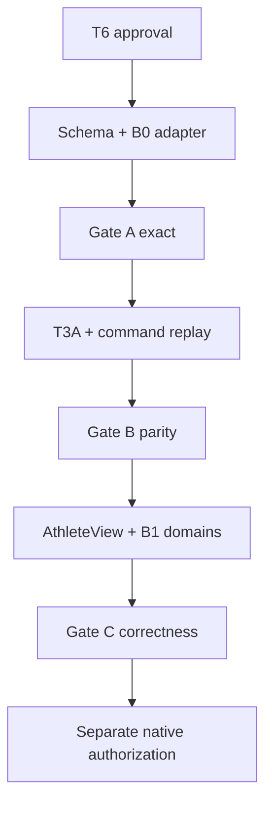

# Proposed Future Implementation Sequence

This is a dependency order, not authorization. T6 ends at specification review.
Each phase requires separate approval and may be split into smaller tasks.

| Phase | Future work | Entry condition | Exit evidence |
|---:|---|---|---|
| 0 | Resolve open canon/interface decisions and freeze schema v1 | T6 review | signed decision register; no unresolved required default |
| 1 | Create neutral legacy adapter and typed telemetry sidecar | Phase 0 | Gate A exact across T1; T5 equivalence retained |
| 2 | Document/extract current MC commands without changing behavior | Phase 1 | intent-to-command traces; delay and target fidelity |
| 3 | Build authorized T3A physical fixtures and cross-replicate traces | O7 approval | Archer/Keeper/jump/hand/pose/receiver/kick gaps covered |
| 4 | Implement command-replay physical boundary | Phase 3 | Gate B for T3/T3A, stable IDs/draw ledger |
| 5 | Implement immutable ObservationFrame/AthleteView projector | O8 and IA-001 detail approval | leak/poison tests; no live state references |
| 6 | Implement individual BeliefState and cognition-only option pipeline | Phase 5 | provenance, cadence, incomplete-information tests |
| 7 | Migrate carrier/off-ball/receiver intent ownership | Phase 6 | no legacy retarget; explicit supersession; Gate C subset |
| 8 | Migrate catching and jump ownership | T6-O1 and jump policy approval | prepared-catch and single-owner jump tests; Gate B unchanged |
| 9 | Implement full PRISM Archer cognition | O6/C-7 details and T3A | AR isolation/fidelity/legality/physical-parity suite |
| 10 | Migrate Keeper cognition and MC | Keeper intent policy + T3A | ownership tests; bounded pathology semantics retained |
| 11 | Remove unauthorized positional anchors for formation-free B1 | O9 and formation-free acceptance approval | neutral/symmetry/emergence tests; rules placements retained |
| 12 | B1 integrated validation | Phases 5–11 | Gate C, outcome envelopes, censored-run reporting |
| 13 | Native implementation planning and port | separate native authorization | Gate A adapter where applicable, Gate B parity, platform evidence |

## Sequencing rules

1. Never combine an information-boundary change with a PHY equation change.
2. Never combine RNG redesign with behavior migration.
3. Add the physical replay fixture before replacing the corresponding owner.
4. Maintain separate B0 and B1 manifests, schemas, evidence roots, and verdicts.
5. A stage that fails Gate A cannot proceed by relabeling the difference B1.
6. A stage that changes behavior intentionally must name the approved decision
   and demonstrate unchanged PHY under identical commands.
7. Native performance work begins only after correctness boundaries are
   executable and profiled; no velocity clamp is an optimization option.

## Proposed review checkpoints

Failure at a gate returns to the producing phase. It does not broaden scope to
physics calibration, rating changes, Keeper repair, or native optimization.
